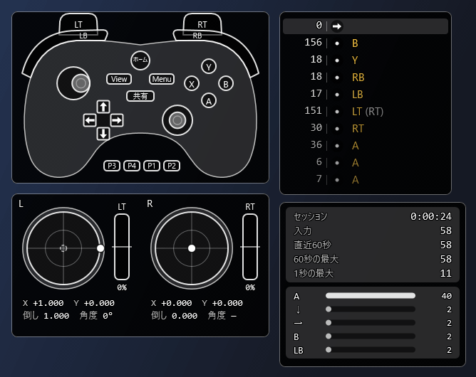
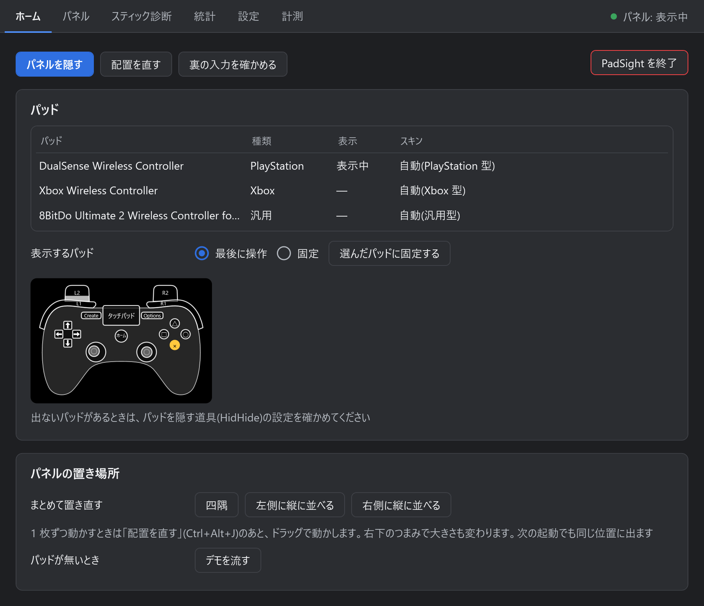

# PadSight

[日本語](README.md)

A Windows tray app that shows your gamepad input in four small panels overlaid on top of your game.
It only reads the pad. It never sends anything to the pad or to the game, except a vibration test that runs only when you press its button on the diagnostics page.
It also includes the features of PadLab, a controller diagnostics tool, as the diagnostics tab.

The user interface is in Japanese only.



(12 seconds of the built-in demo input: left stick circle, down / down-right / right + X (marked as 236), mashing A, triggers, right stick in 8 directions, LB, RB, Y, B.)

## Features

- **Pad view**: pressed buttons, D-pad, stick position and click, and trigger travel, drawn as a pad. Xbox, PlayStation, Switch Pro, Joy-Con pair, arcade stick and generic layouts; chosen automatically from the pad type
- **Input history**: direction (numpad notation) and pressed buttons, one row per change, newest first, with each row's length in frames (60 / 120 / 144 / 240) or milliseconds. Near-simultaneous presses are merged into one row showing their offset, and motions such as 236 and 623 are recognised and badged
- **Sticks**: left and right stick position, trail and values, plus trigger values
- **Diagnostics** (merged from PadLab): pad info (USB / wireless, battery, an SDL-observed report interval) and six pages
  - Buttons: check that every button of the model responds (Xbox, Elite 2, DualShock 4, DualSense, DualSense Edge, Switch Pro, generic), back paddles, and presses that came right after a release (a sign of a worn switch)
  - Sticks: resting drift, outer range shape, snapback, resolution, response smoothness, and a suggested deadzone
  - Triggers: the last 5 seconds of values, and whether they return to 0% and reach 100%
  - Vibration: left/right motors (and Xbox trigger motors), 0.5 s each, only when you press a button
  - Idle watch: records stray presses and wobble while the pad sits untouched
  - History: saved results and a PNG report image
- **Stats**: session length, input count, inputs in the last 60 seconds, peak inputs per second (mashing speed) and per-button counts. Per-pad lifetime totals are kept too, with the most-pressed buttons shaded on the pad picture. Per-session totals are kept and can be viewed by period, as a 30-day bar chart, or exported as CSV
- **Measure**: a 10-second mashing test (count, peak per second, interval spread) and a reaction-time test. A home banner warns when an untouched stick drifts beyond the deadzone
- The pad view flashes a short glow around a button the moment it is pressed
- Panels let clicks through to the window below and never take focus. Hotkeys hide all panels, enter the arrange mode, clear the history and pause the history (defaults Ctrl+Alt+G / J / H / F)
- Panels can be dragged, or rearranged in one click to the corners or stacked on the left or right
- Panel color themes: Classic, Neon, Light, High contrast, and a custom theme with your own background, line and text colors
- Save the panel layout, colors and shown rows as named profiles and switch between them by hand
- A demo mode plays a fixed input pattern so you can see the panels move without a pad (demo input is not counted in the stats)
- A button in Settings downloads the public controller mapping list (SDL_GameControllerDB) so unknown pads and arcade sticks show proper button names
- At startup PadSight tells you when a newer version has been published (can be turned off; it never downloads or replaces itself)
- Lives in the system tray and can start at sign-in



## What it does and does not do

It does:

- Read the input of connected gamepads and show it in small panels at the edge of the screen (read-only)
- Overlay the panels on top of the game, while clicks still reach the game and the game keeps focus
- Keep the length and input counts of each session on this PC

It does not:

- Send anything to the pad (rumble, lights, mode switches), except the vibration test on the diagnostics page, which sends 0.5 s of vibration only when you press its button. Bluetooth PlayStation pads may not vibrate, because of a setting that keeps other apps working
- Touch the game's process, memory or windows, or draw inside the game (it only shows its own transparent windows)
- Read keyboard or mouse input (only the registered hotkeys)
- Store the order or timing of inputs, or require administrator rights. The only network use is two GitHub requests (downloading the controller mapping list when you press the button, and a new-version check at startup that you can turn off); no pad data or stats are sent

## Please read before use

- **No promise about bans.** PadSight does not touch game processes or memory, but a transparent topmost window looks the same as what external cheats use. PadSight cannot promise that games with anti-cheat will not flag it. Do not use it with games you are unsure about, and check each game's terms
- **It does not appear over exclusive-fullscreen games.** Play in borderless or windowed mode
- **Do not launch it from Steam.** Steam's virtual pads may show up instead of your real pad
- **SmartScreen may warn you.** The exe is not code-signed
- Xbox, PlayStation, DualShock, DualSense, Nintendo Switch and Joy-Con are trademarks of their respective owners. PadSight is not affiliated with them. The pad drawings are original shapes; no manufacturer logos or images are used

## Requirements

- Windows 11 (x64)
- Gamepads: Xbox-family (XInput), PlayStation (DualShock 4, DualSense), Switch (Pro Controller, Joy-Con) and generic pads, read through [SDL3](https://libsdl.org/)
- To build from source: .NET 10 SDK

## Build and run

```
git clone https://github.com/takosasi-dev/padsight.git
cd padsight
dotnet build PadSight.slnx
dotnet test tests/PadSight.Tests/PadSight.Tests.csproj
dotnet run --project src/PadSight.App
```

`tools\publish.ps1` builds a single-file exe and a zip into `dist\`.

```
powershell -ExecutionPolicy Bypass -File tools\publish.ps1
```

Prebuilt binaries will be published on [Releases](https://github.com/takosasi-dev/padsight/releases) after testing with real pads.

Other tools:

| Item | Purpose |
|---|---|
| `tools\PadProbe` | Prints pads and input events to the console (`PadProbe hints` / `list --config A` / `watch --config A --seconds 60`) |
| `tools\OverlayProbe` | Shows a single overlay window to test click-through |
| `tests\fixtures\DummyGame` | A full-screen test window that only counts clicks |
| `tools\check.ps1` | Searches the source for APIs that would touch other processes, use the network outside WebFetch.cs, or write to pads |
| `tools\StartSmoke` | Runs only the start of the app (App setup) without a window. Used by CI and `publish.ps1` |
| `tools\PerfProbe` | Measures input processing time and allocations with synthetic input |
| `tools\UiPerfProbe` | Renders the panels and the main window without a window and measures per-frame time and allocations. `shots` and `diff` compare before/after images pixel by pixel |
| `tools\readme-gif.ps1` | Rebuilds the animation in this README (needs ffmpeg) |

Data lives in `%LOCALAPPDATA%\PadSight\` (settings, session totals, logs). To add controller mappings, place `gamecontrollerdb.txt` from [SDL_GameControllerDB](https://github.com/mdqinc/SDL_GameControllerDB) in the same folder (up to 1 MB).

## Status

v0.1.0 (in development). All features are in place and the unit tests (420) pass, but **it has not yet been tested with real pads**. The default input backend, the check that pads are left unchanged, and performance measurements are still to be done on real hardware.

## License

[MIT](LICENSE). Third-party licenses are in [THIRD-PARTY-NOTICES.md](THIRD-PARTY-NOTICES.md) (SDL and SDL3-CS: zlib; H.NotifyIcon: MIT).
