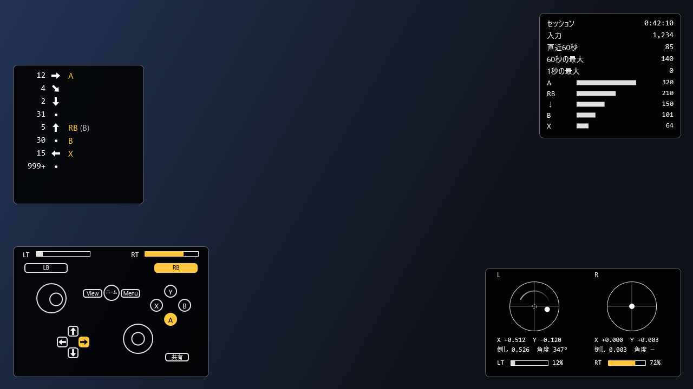
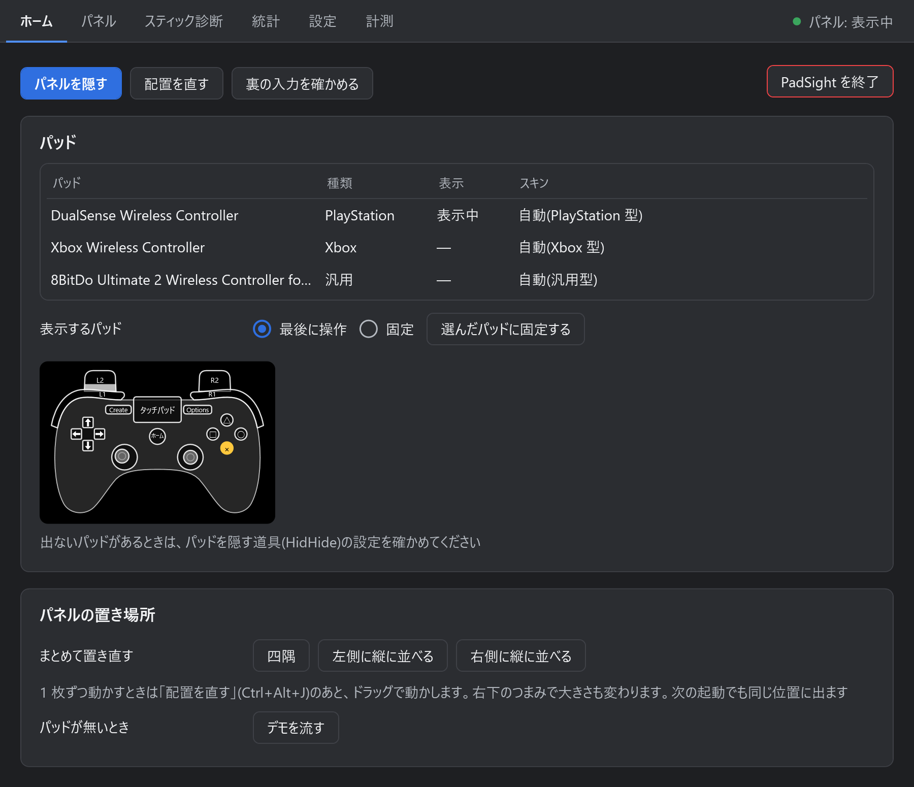

# PadSight

[English](README.en.md)

ゲームパッドの入力を、ゲームの画面の上に重ねた 4 枚の小さいパネルで見せる、Windows の常駐ソフトです。
パッドは読むだけで、パッドにもゲームにも何も送りません。



## 主な機能

- **パッド表示**: 押しているボタン、十字キー、スティックの位置と押し込み、トリガーの押し具合を、パッドの絵で出します。Xbox 型・PlayStation 型・Switch Pro 型・Joy-Con ペア型・アケコン型・汎用型の絵があり、パッドの種類から自動で選びます
- **入力履歴**: 方向(テンキー表記)と押したボタンを新しい順に 1 行ずつ出し、各行の長さをフレーム数(60 / 120 / 144 / 240)かミリ秒で出します
- **スティック**: 左右のスティックの位置・軌跡・数値と、トリガーの値を出します。メインの画面では、手を離したときのずれと外周の形を測れます
- **統計**: セッションの長さ、入力の回数、直近 60 秒の回数、1 秒の最大(連打の速さ)、ボタン別の回数を出します。パッドごとの通算も残ります。セッションごとの集計を残し、期間ごとに見られます。CSV にも書き出せます
- パネルはクリックを下の窓へ通し、フォーカスを取りません。ホットキーで全部を隠す・置き場所を変える・入力履歴を消すことができます(既定は Ctrl+Alt+G・J・H)
- パネルはドラッグで動かせるほか、四隅・左側・右側にまとめて並べ直せます
- タスクトレイに常駐し、ログオン時に起動できます



## すること・しないこと

すること:

- つないだゲームパッドの入力を読み、画面の端の小さいパネルに出します(読むだけです)
- パネルはゲームの上に重なりますが、クリックは下のゲームに届き、ゲームのフォーカスは取りません
- セッションごとに、長さと入力の回数を、この PC の中に残します

しないこと:

- パッドに何も送りません(振動、ランプ、モードの切り替え)
- ゲームのプログラム・メモリ・窓には触りません。ゲームの中に描きません(自分の透明な窓を重ねるだけです)
- キーボードとマウスの入力は読みません(登録したホットキーだけを受け取ります)
- 押した順番や時刻は残しません。通信しません。管理者の権限を使いません

## 使う前に読んでください

- **BAN されないことは約束できません。** PadSight はゲームのプロセスにもメモリにも触りませんが、「透明で最前面の窓」という形は、外部のチートと同じです。アンチチートのあるゲームで問題が起きないことを、このソフトは約束できません。気になるゲームでは使わず、遊ぶゲームの規約を確かめてください
- **排他フルスクリーンのゲームの上には出ません。** ボーダーレスかウィンドウで遊んでください
- **Steam から起動しないでください。** Steam の仮想パッドが見えて、実物のパッドが見えないことがあります
- **SmartScreen の警告が出ることがあります。** exe にコード署名をしていないためです
- Xbox、PlayStation、DualShock、DualSense、Nintendo Switch、Joy-Con は、各社の商標です。PadSight は各社と関係がありません。パッドの絵は自分で描いた図形で、メーカーのロゴや画像は使っていません

## 動作環境

- Windows 11(x64)
- ゲームパッド: Xbox 系(XInput)、PlayStation(DualShock 4・DualSense)、Switch(Pro コントローラー・Joy-Con)、汎用のパッド。読み取りには [SDL3](https://libsdl.org/) を使います
- ソースからビルドする場合: .NET 10 SDK

## ビルドと実行

```
git clone https://github.com/takosasi-dev/padsight.git
cd padsight
dotnet build PadSight.slnx
dotnet test tests/PadSight.Tests/PadSight.Tests.csproj
dotnet run --project src/PadSight.App
```

配布用の単一ファイルの exe と zip は `tools\publish.ps1` で `dist\` に作ります。

```
powershell -ExecutionPolicy Bypass -File tools\publish.ps1
```

ビルド済みの exe は、実機での確認が済んだら [Releases](https://github.com/takosasi-dev/padsight/releases) に置きます。

そのほかの道具:

| 物 | 用途 |
|---|---|
| `tools\PadProbe` | パッドの一覧とイベントをコンソールに出す(`PadProbe hints` / `list --config A` / `watch --config A --seconds 60`) |
| `tools\OverlayProbe` | 重ねる窓を 1 枚だけ出して、クリックが抜けるかを試す |
| `tests\fixtures\DummyGame` | クリックの回数を数えるだけの、試験用の全画面の窓 |
| `tools\check.ps1` | 他のプロセス・通信・パッドへの書き込みにつながる API がソースに無いかを検索する |

データは `%LOCALAPPDATA%\PadSight\` に置きます(設定、セッションの集計、ログ)。割り当てを足したいときは、[SDL_GameControllerDB](https://github.com/mdqinc/SDL_GameControllerDB) の `gamecontrollerdb.txt` を同じフォルダに置いてください(1 MB まで)。

## 開発の状況

v0.1.0(開発中)。機能はひととおり入っていて、単体テスト(198 件)は通っていますが、**実機のパッドでの確認はまだです**。入力の取り方の既定、パッドの状態を変えないことの確認、性能の測定は、これから実機で行います。

## ライセンス

[MIT](LICENSE)。使っている部品のライセンスは [THIRD-PARTY-NOTICES.md](THIRD-PARTY-NOTICES.md) にあります(SDL と SDL3-CS は zlib、H.NotifyIcon は MIT)。
